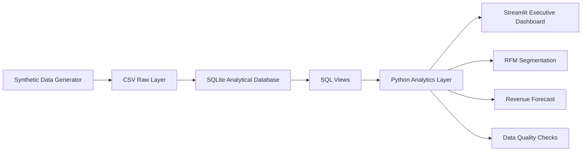

# Executive Business Intelligence & Sales Forecasting Platform

A portfolio-ready analytics application that demonstrates an end-to-end business intelligence workflow using **SQL, Python, Streamlit, Plotly, customer segmentation, forecasting, and data-quality controls**.

> **Important:** All data in this repository is synthetic and generated locally. It does not represent a real company or client.

## Business scenario

Northstar Commerce Group is a fictional multi-region omnichannel retailer. Leadership needs one analytical workspace to monitor revenue, profitability, customer behaviour, product performance, channel mix, returns, and forward revenue expectations.

The project answers practical executive questions such as:

- How much revenue and gross profit are we generating?
- Which regions, countries, channels, categories, and products drive performance?
- What is the current gross margin and average order value?
- Which customers are Champions, Loyal, Potential, At Risk, or Hibernating?
- How are sales changing over time?
- What revenue could the business expect over the next 3–12 months?
- Are there visible data-quality issues that could undermine decision-making?

## What this project demonstrates

- **Analytics engineering:** raw CSVs → relational analytical database → reusable SQL views
- **SQL:** fact/dimension schema, indexes, joins, monthly KPI views
- **Python analytics:** KPI calculations, filtering, aggregation, customer RFM segmentation
- **Business intelligence:** executive dashboard design and decision-oriented visualisation
- **Forecasting:** Holt-Winters trend/seasonality model with fallback logic
- **Data quality:** explicit checks for missing values, duplicates, negative sales, and invalid profit relationships
- **Software delivery:** tests, Docker configuration, cross-platform run scripts, documentation

## Architecture



## Data model

The local analytical database follows a simple dimensional pattern:

- `fact_sales` – order-line transactions
- `dim_customer` – customer profile, geography, and customer type
- `dim_product` – product, category, price, and cost attributes
- `vw_sales_enriched` – reusable joined analytical view
- `vw_monthly_kpis` – monthly KPI aggregation for reporting

## Dashboard sections

### 1. Executive Overview
Revenue, gross profit, gross margin, orders, average order value, revenue trend, regional performance, channel mix, and category profitability.

### 2. Sales Performance
Channel performance over time, country-level revenue, and weekday sales patterns.

### 3. Customer Intelligence
RFM segmentation and top-customer analysis.

### 4. Product Performance
Top products by revenue, profitability matrix, units sold, margins, and returns.

### 5. Revenue Forecast
A 3–12 month revenue forecast based on monthly sales history. When enough history is available, the application uses Holt-Winters exponential smoothing with trend and seasonality.

### 6. Data Quality
Pipeline-level checks that demonstrate that BI outputs should be validated rather than blindly trusted.

## Quick start

### Prerequisites

- Python 3.10+
- `pip`

### Windows

```bat
python -m venv .venv
.venv\Scripts\activate
pip install -r requirements.txt
run_app.bat
```

### macOS / Linux

```bash
python3 -m venv .venv
source .venv/bin/activate
pip install -r requirements.txt
./run_app.sh
```

Then open the local Streamlit address shown in your terminal, normally:

```text
http://localhost:8501
```

## Manual setup

```bash
python setup_project.py
streamlit run app.py
```

`setup_project.py` generates the synthetic source data if it does not already exist and then rebuilds the SQLite analytical database.

## Docker

```bash
docker compose up --build
```

Open `http://localhost:8501`.

## Run the tests

```bash
pytest -q
```

## Repository structure

```text
executive-bi-sales-forecasting/
├── app.py
├── setup_project.py
├── requirements.txt
├── Dockerfile
├── docker-compose.yml
├── pytest.ini
├── run_app.sh
├── run_app.bat
├── sql/
│   ├── 01_schema.sql
│   └── 02_views.sql
├── src/
│   ├── analytics.py
│   ├── config.py
│   ├── data_generator.py
│   ├── database.py
│   └── forecasting.py
├── data/
│   ├── raw/
│   └── processed/
├── tests/
│   ├── test_analytics.py
│   └── test_forecasting.py
├── powerbi/
│   ├── README.md
│   └── measures.dax
└── docs/
    ├── PORTFOLIO_CASE_STUDY.md
    └── LINKEDIN_PROJECT_COPY.md
```

## KPI definitions

| KPI | Definition |
|---|---|
| Revenue | Net sales after discounts and recorded returns |
| Gross Profit | Net sales minus product cost, adjusted for returns |
| Gross Margin | Gross profit ÷ revenue |
| Orders | Distinct order IDs |
| Customers | Distinct purchasing customers |
| Units | Sum of units sold |
| Average Order Value | Revenue ÷ distinct orders |
| Return Rate | Return amount ÷ gross sales |

## Optional Power BI companion

The `powerbi/` folder includes a build guide and starter DAX measures so you can recreate the same KPI model in Power BI using the generated fact and dimension tables.

## Forecasting notes

The forecasting component is intentionally explainable and lightweight for a portfolio project. It uses monthly revenue and applies Holt-Winters exponential smoothing when sufficient history is available. The displayed uncertainty band is residual-based and should be interpreted as an indicative planning range, not a formal probabilistic confidence interval.

In a production setting, the next steps would include rolling-origin backtesting, model comparison, external regressors, hierarchical forecasts, and prediction interval calibration.

## Suggested portfolio talking points

When presenting this project to an employer, focus on the decisions the system supports rather than only the tools:

1. I designed a reusable analytical model instead of analysing flat files directly.
2. I translated transactions into executive KPIs with consistent business definitions.
3. I added customer RFM segmentation to turn sales history into actionable customer groups.
4. I added forecasting to move the dashboard from descriptive reporting toward planning.
5. I included data-quality controls because executive reporting is only useful when the underlying data can be trusted.

## Future enhancements

- PostgreSQL warehouse option
- Scheduled ETL with Airflow or Prefect
- Role-based authentication
- Budget vs actual variance analysis
- Cohort retention analysis
- Forecast backtesting and model leaderboard
- Power BI semantic model using the same analytical database
- Cloud deployment with CI/CD

## License

MIT License. See `LICENSE`.
